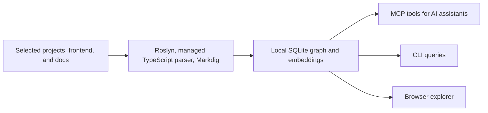

# SharpSense

**Built in .NET, for .NET developers.**

A local code knowledge graph that gives your AI assistant the symbols, callers, dependencies, and documentation
it needs to understand your codebase. SharpSense combines Roslyn-powered C# analysis, TypeScript frontends, and
Markdown documentation in one workspace, accessible through MCP, the CLI, and a browser UI.

[Demo](#see-it-in-action) · [Quick start](#quick-start) · [Benchmarks](#benchmarks) · [AI integrations](#connect-your-ai-assistant) ·
[Documentation](https://github.com/mivbox/sharpsense/blob/main/docs/wiki/index.md) · [Contributing](#development)

## See it in action

A 69-second walkthrough: start with an empty home, add the SharpSense solution, TypeScript frontend, and
documentation, index the workspace, then explore search, symbol context, implementations, and graph statistics.
Repository and user-home paths are masked in this recording.

https://github.com/user-attachments/assets/3f33ba29-c914-4842-8e1d-3977bf36452d

## Quick start

Requires the **.NET 10 SDK**. Install the tool, select your solution, and build the graph:

```bash
dotnet tool install --global SharpSense.Cli
sharpsense workspace create my-app --workspace-root . --csharp MyApp.sln
sharpsense analyze --workspace my-app
sharpsense ui --workspace my-app
```

Replace `MyApp.sln` with your solution or project. Open **http://localhost:50069** to explore the graph.
You can also run `sharpsense ui` first and create a workspace through the browser.

Update with `dotnet tool update --global SharpSense.Cli`. The installed CLI and UI do not require Node.js or pnpm.

## Why SharpSense?

Before changing a method, find its callers. Before changing an interface, find its implementations. When a decision
matters, attach it to the relevant symbol so the next investigation can retrieve it.

| Capability | What it gives you |
| --- | --- |
| **C# semantic analysis** | Roslyn-backed symbols and relationships across your selected projects. |
| **One graph for your stack** | C#, TypeScript/TSX, and Markdown in a named workspace. |
| **Focused agent context** | Search, immediate relationships, dependency traces, and impact analysis through MCP. |
| **Browser exploration** | Manage workspaces, run analysis, inspect the graph, and try queries visually. |
| **Persistent memories** | Attach decisions and conventions to symbols; source changes can mark notes stale. |
| **Watch mode** | Refresh the graph as files change and reuse unchanged embeddings. |
| **Local storage and embeddings** | Keep workspace configuration, the SQLite index, and authored memories on your machine. |

Your AI client controls where the context it retrieves is sent. SharpSense does not require a hosted graph service.

## Benchmarks

**The same question, with and without SharpSense.** These read-only investigations use SharpSense's source,
Codex with `gpt-6-astra` at `xhigh`, and three fresh sessions per question per condition. Both conditions have access to the
same skills, file search, and reading; the SharpSense condition also has its MCP graph tools. Values below are
medians, measured 16 October 2026.

| Source | Tokens without | Tokens with | Token change | Time without | Time with | Time change |
| --- | ---: | ---: | ---: | ---: | ---: | ---: |
| C# | 220,279 | 147,614 | **33.0% fewer** | 74.4 s | 63.1 s | **15.2% less** |
| TypeScript / TSX | 203,525 | 220,656 | 8.4% more | 67.5 s | 79.4 s | 17.6% more |
| Markdown | 101,194 | 124,917 | 23.4% more | 43.0 s | 52.2 s | 21.4% more |

**All 18 answers passed source review.** This small pilot shows savings for the C# investigation and additional
overhead for the TypeScript and documentation questions; results depend on the task and model.

<details>
<summary><strong>The exact questions used in both conditions</strong></summary>

| Source | Question for both runs |
| --- | --- |
| C# | If source extraction fails during indexing, what happens to the previous graph? Show the failure path and its tests. |
| TypeScript / TSX | How does the Analyze button start indexing and display progress? Show the components, API request, and update handling. |
| Markdown | How do the CLI and MCP choose a workspace when no explicit workspace is supplied? Cite the relevant documentation. |

</details>

Tokens are provider-reported input plus output across the whole task, including cached input once. Time includes
agent and MCP startup; the **24.5-second index build** is separate.

## Connect your AI assistant

Install the CLI and analyse a workspace first. The `sharpsense` plugin includes an MCP connection and skills for
exploration, impact analysis, memory maintenance, and reducing command output.

<details>
<summary><strong>Claude Code</strong></summary>

```bash
claude plugin marketplace add mivbox/sharpsense
claude plugin install sharpsense@sharpsense-marketplace
```

</details>

<details>
<summary><strong>Codex</strong></summary>

```bash
codex plugin marketplace add mivbox/sharpsense
codex plugin add sharpsense@sharpsense-marketplace
```

</details>

<details>
<summary><strong>Copilot CLI</strong></summary>

```bash
copilot plugin marketplace add mivbox/sharpsense
copilot plugin install sharpsense@sharpsense-marketplace
```

</details>

Start the client from inside your registered workspace. MCP discovers the workspace only when exactly one registered
root contains that directory. If roots overlap, choose explicitly with `--workspace`.

<details>
<summary><strong>Other MCP clients or explicit workspace selection</strong></summary>

For clients using an `mcpServers` configuration:

```json
{
  "mcpServers": {
    "sharpsense": {
      "command": "sharpsense",
      "args": ["mcp", "--workspace", "my-app"]
    }
  }
}
```

Replace `my-app` with your workspace name or ID. Disable the plugin's automatic MCP connection when replacing it
with a manual entry. Each server stays bound to one workspace; restart it to select another.

</details>

### What your agent can do

| Tool | Purpose |
| --- | --- |
| `semantic_search` | Find symbols and documentation using keyword and vector search. |
| `context` | Inspect a symbol's immediate callers, callees, and inheritance relationships. |
| `trace_node` | Follow dependencies or inspect callers affected by a change. |
| `get_inheritors` | Find direct derived classes and interface implementations. |
| `graph_stats` | Check graph coverage, indexing timings, and diagnostics. |
| `attach_memory`, `get_memory`, `get_memories`, `delete_memory` | Maintain notes attached to indexed symbols. |
| `ctx_execute` | Run a local command and return bounded excerpts relevant to a query. |

Try asking your assistant:

> Find the handler for creating an order, inspect its dependencies, and show the callers affected by changing it.

> Find the implementations of `IPaymentGateway` and the documentation that describes payment retries.

> Attach our idempotency decision to the order handler so future investigations can retrieve it.

See the [MCP guide](https://github.com/mivbox/sharpsense/blob/main/docs/wiki/cli/mcp-command.md) for tool limits and workspace selection, and the
[plugin guide](https://github.com/mivbox/sharpsense/blob/main/docs/wiki/cli/skills-command.md) for installation details.

## How it works



Named workspaces let you select the parts of a repository that belong together. Analysis commits the selected sources
as one graph; failed extraction preserves the previous graph. Watch mode refreshes it as sources change.

Configuration, indexes, logs, and memories live under `~/.sharpsense`. An absolute `SHARPSENSE_HOME` selects a different
storage directory. There is no project-local YAML configuration to maintain.

## CLI at a glance

| Command | Purpose |
| --- | --- |
| `sharpsense workspace create` | Create a workspace with guided setup. |
| `sharpsense workspace ls` | List registered workspaces. |
| `sharpsense workspace use my-app` | Save the default for CLI commands. |
| `sharpsense analyze --workspace my-app` | Build or update the graph. |
| `sharpsense analyze --workspace my-app --watch` | Keep the workspace indexed as sources change. |
| `sharpsense search "payment handler" --workspace my-app` | Search code and documentation. |
| `sharpsense context --node-id 42 --workspace my-app` | Inspect a symbol's immediate relationships. |
| `sharpsense trace 42 --direction caller --workspace my-app` | Find immediate callers. |
| `sharpsense inheritors 42 --workspace my-app` | Find direct implementations or derived classes. |
| `sharpsense doctor --workspace my-app --json` | Check configuration, assets, and database compatibility. |
| `sharpsense ui --workspace my-app` | Open the browser workspace explorer. |
| `sharpsense mcp --workspace my-app` | Start a stdio MCP server. |

Use the node IDs returned by search in subsequent queries. Queries return JSON by default; add `--toon` for compact
output. `analyze --no-embeddings` skips embedding generation. Run `sharpsense --help` for the full command list.

The CLI default and MCP selection are independent: **MCP never reads `workspace use`**. Explicit `--workspace`
selection works from any directory.

## Workspaces for a full stack

Start with a solution, then add frontend sources and documentation:

```bash
sharpsense workspace create commerce --workspace-root . --csharp Commerce.sln
sharpsense workspace add commerce --workspace-root . --typescript frontend/tsconfig.json --markdown "docs/**/*.md"
sharpsense analyze --workspace commerce
```

| Source | Accepted selections |
| --- | --- |
| C# | `.sln`, `.slnx`, or `.csproj` files. |
| TypeScript | A configuration file or source directory. |
| Markdown | A file, directory, or quoted glob. |

One workspace can cover a product; another can select only its API. The UI supports creating, editing, and merging
workspaces with the same root. Reanalyse after changing source selections, and restart an existing MCP session to
load the changed configuration.

See [workspace management](https://github.com/mivbox/sharpsense/blob/main/docs/wiki/cli/workspace-command.md) for source paths, selection rules, merges, and storage.

## Language support

| Language | Analysis | Scope |
| --- | --- | --- |
| C# | Roslyn | Semantic symbols, references, calls, and inheritance from selected projects. |
| TypeScript / TSX | Managed `SharpSense.TypeScript` parser | Declarations, members, components, imports, package dependencies, and statically recognisable HTTP requests. |
| Markdown | Markdig | Documentation nodes and links alongside code. |

TypeScript relationships are syntax-based: import edges describe module dependencies, and do not imply resolved
function calls or type checking. Dynamic imports, computed URLs, runtime dispatch, and arbitrary framework wrappers
have limited coverage. The parser has a July 2024 grammar baseline with targeted compatibility fixes and a pinned
compiler corpus; it does not claim complete support for every later TypeScript release.

See [C# analysis](https://github.com/mivbox/sharpsense/blob/main/docs/wiki/extractors/csharp.md), [TypeScript compatibility and diagnostics](https://github.com/mivbox/sharpsense/blob/main/docs/wiki/extractors/typescript.md),
and [Markdown analysis](https://github.com/mivbox/sharpsense/blob/main/docs/wiki/extractors/markdown.md) for details.

## Development

SharpSense uses .NET 10, vertical slices, and a separate TypeScript UI. Building the CLI from source also requires
Node.js 22.13+ and pnpm 12.6.0 to build and embed the UI.

- [Build and install from source](https://github.com/mivbox/sharpsense/blob/main/src/SharpSense.Cli/README.md#install-from-source)
- [.NET build, formatting, and tests](https://github.com/mivbox/sharpsense/blob/main/docs/wiki/architecture/dotnet-conventions.md)
- [Application architecture](https://github.com/mivbox/sharpsense/blob/main/docs/wiki/architecture/vertical-slice-application.md)
- [UI development](https://github.com/mivbox/sharpsense/blob/main/src/SharpSense.UI/README.md)
- [Complete documentation](https://github.com/mivbox/sharpsense/blob/main/docs/wiki/index.md)

## License

[MIT](https://github.com/mivbox/sharpsense/blob/main/LICENSE). Third-party parser notices are preserved with the [TypeScript library](https://github.com/mivbox/sharpsense/blob/main/src/SharpSense.TypeScript).
